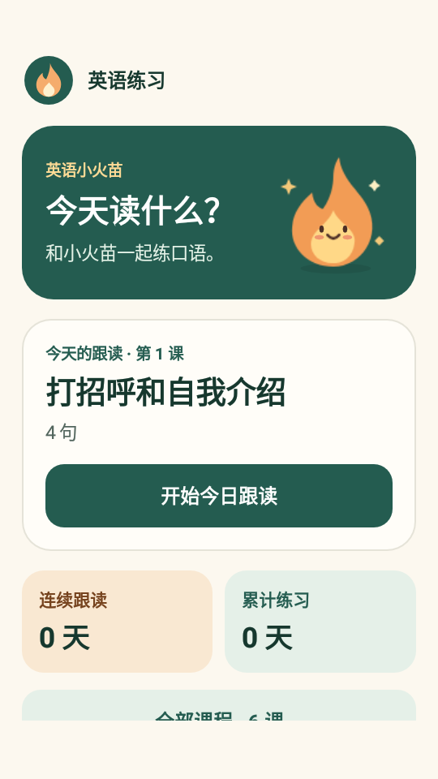

# 英语小火苗 · English Spark

英语小火苗是给小学阶段孩子做的离线英语跟读 App。每天选一课，听一句、读一句，有需要就录下来回听。读完当天第一课，小火苗会亮起来。

[下载安卓安装包](https://github.com/iloveqjh/english-spark/releases/latest) · [项目报告](REPORT.md) · [开发日志](CHANGELOG.md) · [音频与授权](THIRD_PARTY_NOTICES.md)

## 我做这个 App 的起点

我一开始拿到的是两段比较长的英语录音。直接在播放器里反复拖动找句子，孩子很难自己每天练下去。我想让他打开手机就知道今天读什么，先听清一句，再按自己的节奏开口。所以先用四句原音做了一课，跑通跟读和签到，再逐步加上按主题找课、课后听力题和连续练习奖励。

## 可以怎么练

- **一屏一句**。听原音、用 0.75 倍速重听、打开中文提示。听完后自己跟读，再点「我读完了」。
- **录音回听**。第一次点录音时才申请麦克风权限。录音暂存在设备上，换句后清理。
- **找课和复习**。支持按课程名、英文或中文关键词搜索。每课结束后可以玩「听音选意思」。
- **续火花**。每天第一次完成一课会签到，记录连续、累计和最长练习天数。连续 7 天可以写一张心愿券，和家里商量兑现。

公开版内置 **6 课、24 句**，课程来自 VOA Learning English 儿童英语和 Storybooks Canada 的入门故事，覆盖自我介绍、家人、日常对话和故事朗读。音频已随安装包提供。学习记录保存在设备上，App 无需账号。



## 在安卓手机上安装

支持 Android 8.0 及以上。进入 [Releases](https://github.com/iloveqjh/english-spark/releases/latest)，下载 `.apk`。在手机的文件管理器里打开安装包，按系统提示安装。安装后从桌面打开「英语小火苗」。

## 构建源码

使用 Windows PowerShell、JDK 17 或更新版本、Android SDK Platform 36 和 Android SDK Build-Tools 36.0.0。把 `JAVA_HOME`、`ANDROID_HOME` 设为各自的安装目录，从仓库根目录执行：

```powershell
.\android\build-apk.ps1
```

构建脚本会在 `build/` 里生成带本地签名的 APK。如果项目路径含非 ASCII 字符，给脚本传入 `-WorkRoot`，指向只含英文字符的工作目录。首次构建会在本机生成签名材料。用于覆盖更新的 APK 须沿用此前使用的签名。课表在 [`lesson_catalog.json`](android/app/src/main/res/raw/lesson_catalog.json)，每句话的音频以资源名称与课表一一关联。

## 了解项目

- [项目报告](REPORT.md)记录课程为什么这样做、从长录音拆句的过程、功能取舍和验证范围。
- [开发日志](CHANGELOG.md)记录从四句原型到课程库，再到公开版的过程。
- [素材与授权](THIRD_PARTY_NOTICES.md)列出原音出处和改编说明。
